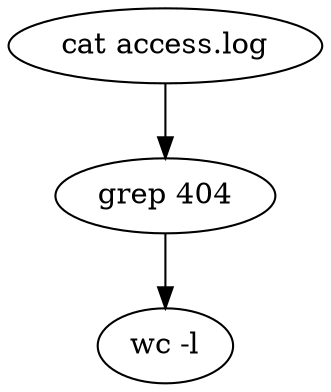

# gripeline

A graph *is* a pipeline.

`gripeline` runs ordinary [Graphviz](https://graphviz.org) `dot` files and
[`modl`](https://modl.hashbin.page/) diagrams as shell pipelines. The same file
you hand to `dot -Tpng` or open in the [modl editor](https://modl.hashbin.page/)
to draw a picture, you hand to `gripeline` to run a `bash` pipeline — the
diagram conveys data flow the way a `cmd1 | cmd2 | cmd3` one-liner does, only
more clearly when it branches.



```modl
log hex    access.log           # grep 404 < access.log | wc -l
g   square grep 404
w   square wc -l
log -> g -> w
```

- **[SPEC.md](SPEC.md)** — execution semantics: how nodes/edges map to
  programs, files, streams, and file descriptors; three mappings (Commands,
  Dataflow, Typed); control flow, variables, loops; what makes a diagram
  renderable-but-not-executable; the `modl` front end and `#gl` comment pragmas
  (§14); and a gallery of bash ⇄ dot ⇄ modl examples.
- **[tests/](tests/)** — a conformance harness and fixtures (including dot/modl
  twin cases) that validate a transpiler (`python3 tests/run.py`). See
  [tests/README.md](tests/README.md).

Status: working transpiler for both `dot` and `modl`.
[`gripeline.py`](gripeline.py) (Python 3, standard library only) parses real
`dot` and `modl`, resolves roles, runs the §9 static check, and emits identical
`bash` from either front end. Run it via the [`gripeline`](gripeline) shim:

```bash
./gripeline build foo.dot     # or foo.modl — print transpiled bash to stdout
./gripeline run   foo.modl    # transpile then exec under bash
./gripeline check foo.modl    # §9 static check only (exit 0, or 65 if not executable)
./gripeline run   'https://modl.hashbin.page/#h1=...'   # run a modl share link directly
```

The conformance harness passes under either invocation form:

```bash
GRIPELINE=./gripeline            python3 tests/run.py
GRIPELINE='python3 gripeline.py' python3 tests/run.py
```

## Published site

The [spec](SPEC.md) (with every Graphviz diagram rendered to SVG and every
`modl` diagram linked to open in the [modl editor](https://modl.hashbin.page/))
and the conformance test results (a pass/fail index, plus a page per test
showing the source `dot` and `modl`, rendered diagrams, expected bash, and the
transpiler's actual output) are published to GitHub Pages at
<https://curtcox.github.io/gripeline/>.

A push to `main` rebuilds and redeploys it via
[`.github/workflows/pages.yml`](.github/workflows/pages.yml). The site is
generated by [`site/build.py`](site/build.py) — Python 3 standard library only,
plus the Graphviz `dot` CLI for rendering. Build it locally with:

```bash
python3 site/build.py        # writes site/_site/ ; open site/_site/index.html
```

## Contributing

Run `make check` (the conformance fixtures plus unit tests; Python 3 standard
library only). [AGENTS.md](AGENTS.md) has the full contributor guide: the
rules, a code map, and contracts that are easy to break. It is written for
both people and coding agents.

Modl supports native groups (`ID title {` / `}`), bracket ports
(`a[err] -> b[3]`), and `double` stderr edges. `note`/`cylinder` are file
shapes; `hex` remains supported. See SPEC §14.4 for compatibility details.
Use `./gripeline check --annotate --link file.modl` to print a review link
on stderr instead of writing an annotated copy. Whole-line `#gl` settings
always target the graph, even inside a block.

## Editor and portable execution

The site build includes `/editor/`: source, diagram, bash, diagnostics, share
links, downloads, and a gallery generated from conformance fixtures. It runs
the real Python compiler under a pinned, self-hosted Pyodide worker. Links
never execute commands. Review the bash before copying a local-run command.

```sh
./gripeline build - < pipeline.modl
./gripeline run t256:AAAAAAAA
./gripeline check --portable pipeline.modl
./install.sh                       # default: ~/.local/bin
python3 scripts/vendor.py          # verify pinned browser assets
python3 scripts/vendor.py --fetch  # restore missing assets, checking hashes
```

On Windows, run `./install.ps1` from a reviewed checkout, then open a new
terminal. Python (`py -3`) and Git for Windows Bash are required. Set
`GRIPELINE_BASH` to select Bash explicitly. WSL is supported by running the
Linux installation inside WSL; a Windows Python process rejects the WSL Bash
launcher. Install native t256 from [256t.org](https://256t.org) for CID inputs.

A source file node `t256:CID` emits `t256 load CID`; a sink `t256:` emits
`t256 save -f t256 -`, printing its reference. Use `#gl requires ...` to declare
tools and `#gl env ...` to declare intended environments. t256 provides the
portable operations `load` (instead of curl/wget/Invoke-WebRequest), `cid` and
`verify` (instead of sha256sum/shasum/certutil), and `save` (instead of ad-hoc
uploads). CID syntax and content verification use t256's SHA-512 identifiers.

The Apptron target remains disabled until its gripeline overlay is released.
HashBin publishing and a canonical dedicated origin require external app
registration. See [EDITOR_PLAN.md](EDITOR_PLAN.md) for current phase status.

The editor's environment badges combine declared requirements with first command
words. Baseline inventories are in `web/portable-tools.json`; native targets
assume Python, Bash and t256 are installed. They are advice, not detection of
your installed tools or a check of every shell option. The local-run dialog
lets you select a platform and disables copying for excluded environments.
Portable t256 count, save and transform examples are executed in each CI OS
with the verified release binary.
