# gripeline — a specification for executing Graphviz `dot` and `modl` files as shell pipelines

**Status:** Draft 0.4 (design exploration)
**Source languages:** unmodified Graphviz `dot` and [`modl`](https://modl.hashbin.page/)
**Execution model:** transpile to `bash`
**Scope:** pipes, files, file-descriptor routing, fan-out/fan-in, sequencing &
conditionals, subshells/functions, variables, command substitution, and loops.

> A `gripeline` program is an ordinary Graphviz `dot` file or [`modl`](https://modl.hashbin.page/)
> file. The same file you can hand to `dot -Tpng` or open in the modl editor to
> draw a picture, you can hand to `gripeline` to run a shell pipeline. This
> document defines what that file *means* when it is run.

---

## Table of contents

1. [Goals and non-goals](#1-goals-and-non-goals)
2. [How source text becomes a program](#2-how-source-text-becomes-a-program)
3. [The execution graph vs. the rendering attributes](#3-the-execution-graph-vs-the-rendering-attributes)
4. [Three mappings (and how they relate)](#4-three-mappings)
   - [4.1 The Commands mapping](#41-the-commands-mapping--nodes-are-programs-edges-are-pipes)
   - [4.2 The Dataflow mapping](#42-the-dataflow-mapping--nodes-are-data-edges-are-programs)
   - [4.3 The Typed mapping](#43-the-typed-mapping--typed-nodes-the-general-model)
   - [4.4 Declaring the mapping](#44-declaring-the-mapping)
5. [File descriptors and ports](#5-file-descriptors-and-ports)
6. [Control flow: sequencing, conditionals, grouping](#6-control-flow)
7. [Variables and command substitution](#7-variables-and-command-substitution)
8. [Loops](#8-loops)
9. [Renderable but not executable: diagnostics](#9-renderable-but-not-executable)
10. [Reserved attribute reference](#10-reserved-attribute-reference)
11. [Conformance](#11-conformance)
12. [Example gallery (bash ⇄ all three mappings)](#12-example-gallery)
13. [Resolved decisions](#13-resolved-decisions)
14. [modl source](#14-modl-source)

---

## 1. Goals and non-goals

**Goals**

- Let a person *author a shell pipeline by drawing a graph*, where the picture
  conveys data flow at least as clearly as `cmd1 | cmd2 | cmd3` conveys it
  textually — and usually more clearly for anything that branches.
- Keep the source 100% valid `dot` or `modl`: it must render with stock Graphviz
  or the [modl editor](https://modl.hashbin.page/), and it must run with
  `gripeline`, with no preprocessing.
- Make the common case trivial: a straight chain of arrows is a straight pipe.
- Cover *as much of bash as can be expressed without hurting readability* — up to
  and including variables and loops — while letting a diagram opt to use only a
  tiny subset.
- When a diagram can be drawn but not run, say *why*, both as text and as
  annotations layered back onto the drawing.

**Non-goals**

- Reproducing every bash builtin, expansion rule, or quoting corner. gripeline
  targets the readable 90%; an escape hatch (`gl_raw`) covers the rest.
- Being a new general-purpose language. The semantics are defined *by
  translation to bash*. If you want to know exactly what a graph does, read the
  bash it transpiles to.
- Layout. gripeline never positions nodes; that is Graphviz's or modl's job.

---

## 2. How source text becomes a program

`gripeline` accepts **two source languages** — Graphviz `dot` (`.dot`, `.gv`)
and [`modl`](https://modl.hashbin.page/) (`.modl`) — and translates both into
the **same execution graph** (`Model`), so **both front ends emit identical bash
for the same program**. Sections §§3–10 present the model using `dot` syntax;
[§14](#14-modl-source) specifies how `modl` syntax and `#gl` comment pragmas map
onto that same model.

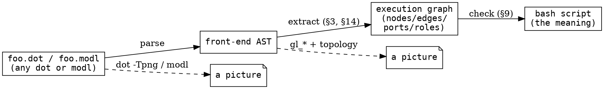

`gripeline run foo.dot` (or `gripeline run foo.modl`) =

1. **Parse** the source file (`dot` or `modl`; format is detected from the file
   extension, `--lang=dot|modl`, or the leading token).
2. **Extract** the *execution graph* (§3, §14) by reading only
   execution-relevant information and discarding pure styling.
3. **Check** executability (§9). If it fails, emit diagnostics and (optionally) a
   red-annotated copy of the graph, and stop.
4. **Transpile** to bash and either print it (`gripeline build`) or run it
   (`gripeline run`).

The transpiler emits bash that runs under a configurable prologue (default
`set -euo pipefail`). **The bash output is the normative definition of what a
graph means.** Every rule below is ultimately "…which transpiles to *this*
bash."

---

## 3. The execution graph vs. the rendering attributes

A dot file mixes two kinds of information. gripeline reads the first and ignores
the second.

**Execution-relevant (read):**

- The graph *kind*: `digraph` is required (a `graph` is not executable, §9).
- Node identities, the nesting of `subgraph`/`cluster` blocks.
- Edge endpoints and their **ports** (`a:1 -> b:0`).
- A node's **operation text**, taken from `label` if present, else the node id.
- An edge's **operation text** (used by the Dataflow mapping), taken from its
  `label`.
- The reserved `gl_*` attributes (§10) and the role-bearing `shape` values.

**Rendering-only (ignored by execution):**

- `pos`, `width`, `height`, `rankdir`, `ranksep`, `nodesep`, `splines`, …
- `color`, `fillcolor`, `bgcolor`, `fontname`, `fontsize`, `fontcolor`,
  `penwidth`, `style` (as decoration), `peripheries`, `image`, …
- `shape`, *except* for the small reserved set that denotes a role (§10).

> A diagram may be 90% rendering attributes — colors, clusters drawn for visual
> grouping, ranks, fixed positions — and gripeline will simply not look at them.
> This is intentional: the picture you tune for a slide deck is the same file
> that runs.

**Semantics live in `gl_*`, not in styling.** It is tempting to say "a dashed
edge means sequencing." In `dot`, gripeline does *not* infer meaning from
`style`/`color`, because that would make the same picture mean different things
after a cosmetic edit (in `modl`, which has no key-value attribute syntax, a
small set of shapes and the `dashed` line style carry default roles and control
edge kinds while `#gl` comment pragmas carry explicit attributes; see
[§14](#14-modl-source)). Instead, meaning is carried by reserved attributes, and
the spec *recommends a matching visual convention* so the drawing looks like
what it does:

| meaning            | reserved attribute     | recommended styling (optional) |
|--------------------|------------------------|--------------------------------|
| pipe (data)        | *(default)*            | solid black                    |
| sequence `;`       | `gl_edge=seq`          | `style=dashed`                 |
| and `&&`           | `gl_edge=and`          | `color=darkgreen,label="&&"`   |
| or `\|\|`          | `gl_edge=or`           | `color=orange,label="\|\|"`    |
| redirect to file   | *(file node endpoint)* | `style=bold`                   |

An implementation MAY offer a `--infer-style` mode that *also* reads the visual
convention, but conforming default behavior reads only `gl_*` + topology.

---

## 4. Three mappings

The same shell concepts — **programs**, **streams/files**, **the wiring between
them** — can be assigned to a graph's **nodes** and **edges** in three ways,
which this spec names by what a *node* represents:

| mapping        | a **node** is…        | an **edge** is…   | best at                         |
|----------------|-----------------------|-------------------|---------------------------------|
| **Commands**   | a program             | a pipe            | straight pipelines (the 90%)    |
| **Dataflow**   | a value / stream      | a program (label) | reuse, fan-out, variables       |
| **Typed**      | a typed thing (role)  | role-dependent    | everything; the general model   |

They are not three different languages; they are three *conventions* over the
same file format, and they interoperate through one underlying model (the Typed
mapping).

Quick taste, all computing `cat access.log | grep 404 | wc -l`:

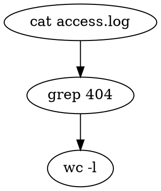
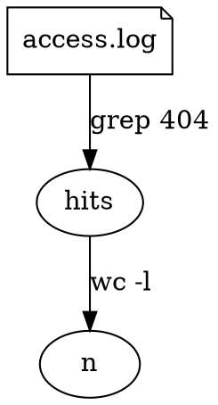
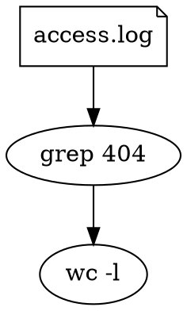

### 4.1 The Commands mapping — nodes are programs, edges are pipes

The literal pipeline. The thing you see in the boxes is the command; the arrow is
the `|`.

**Rules**

- **Node = a command invocation.** Its command line is `label` if present, else
  the node id. (Use ids as short handles; put the real command in `label`.)
- **Edge = a pipe.** `a -> b` means "connect `a`'s stdout to `b`'s stdin," i.e.
  `a | b`. (Generalized by ports, §5.)
- **A file** is a node with `shape=note` (or `gl_role=file`); its `label` is the
  path. A file node as an edge *tail* is a read (`<`); as a *head* it is a write
  (`>`, or `>>` with `gl_append=true`).
- **Fan-out** (a node with several data out-edges) → `tee` / process
  substitution (§12.4).
- **Fan-in** (several data edges into one stdin) → `cat <(…) <(…)` (§12.5).
- **Grouping** uses `subgraph cluster_*` → subshell `( … )`, or a function with
  `gl_role=function` (§6).

A straight chain of *n* nodes is an *n*-stage pipeline. This is the mapping that
most directly answers "make it look like a bash pipeline."

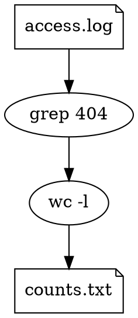

### 4.2 The Dataflow mapping — nodes are data, edges are programs

Nodes are *values* flowing through the system; an edge is the *transformation*
that turns the value at its tail into the value at its head, and the
transformation's command is the **edge `label`**.

**Rules**

- **Node = a named value/stream/file.** A node with no in-edges is an *input*; a
  node with no out-edges is an *output*. A node with `shape=note` (or whose
  id/label is a path) is a real file; otherwise it is an anonymous buffer
  realized as a pipe or temp file.
- **Edge = a program.** `x -> y [label="grep 404"]` means `y` is `x` filtered by
  `grep 404`. A linear chain `i -> a -> b -> o` with edge labels is the pipeline
  `<i  prog_a | prog_b  >o`.
- **Fan-out is natural**: a value node with several out-edges is a value consumed
  by several programs (transpiles via `tee`/process substitution or by
  materializing the node).
- **Multi-input programs are awkward**: a dot edge has exactly one tail, so a
  program that consumes two values needs a *junction node* (`gl_role=op`, label =
  the program) with several in-edges. This is the Dataflow mapping leaking toward
  Typed, and is the main reason it is not always the most concise (see §12.5).
- **Variables are beautiful** here: a node *is* a named value, so
  `today [label="$(date +%F)"]` defines a variable other edges can reference
  (§7).

Dataflow shines when intermediate data is *named and reused*; it is verbose for a
plain `a | b | c` (you must name the otherwise-anonymous streams) and clumsy for
control flow.

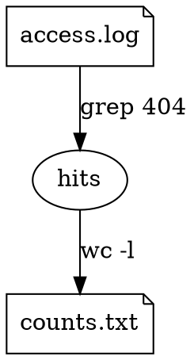

### 4.3 The Typed mapping — typed nodes (the general model)

The Commands and Dataflow mappings are special cases of one model: **every node
has a role, and an edge's meaning is determined by the roles of its endpoints.**
Typed is the model the transpiler actually works in; the other two are
restrictions that fix most roles by convention so you don't have to spell them
out.

**Node roles** (from `shape`, or explicitly `gl_role=…`):

| role      | how to write it (dot)                 | how to write it (modl)             | meaning                              |
|-----------|---------------------------------------|------------------------------------|--------------------------------------|
| `program` | `shape=box`/default, or any box-ish   | `square` / neutral (`circle`/`none`) | a command (text from `label`/id)   |
| `file`    | `shape=note`                          | `hex`                              | a file on disk (`label` = path)      |
| `stream`  | `shape=cds`                           | `triangle`                         | a named buffer / fifo                |
| `value`   | `shape=oval` + `gl_role=value`        | `diamond`                          | a variable (§7)                      |
| `op`      | `shape=box` + multiple typed inputs   | `#gl role=op`                      | a multi-input program / merge point  |
| `control` | `gl_role=for`/`while`/`if`/`function` | `#gl begin …` (§14.2)              | a control construct (§6, §8)         |

**Edge meaning by endpoint roles:**

| tail → head             | meaning              | bash                         |
|-------------------------|----------------------|------------------------------|
| program → program       | pipe                 | `tail \| head`               |
| file → program          | read redirect        | `head < file`                |
| program → file          | write redirect       | `tail > file` (`>>` append)  |
| program → program ports | fd wiring            | see §5                       |
| value → program         | variable use         | `$value` substituted (§7)    |
| program → value         | capture              | `value=$(tail)` (§7)         |

Because roles are explicit, Typed handles everything Commands and Dataflow handle
*and* the cases each finds awkward (multi-input ops, files mixed with pipes, fd
routing, variables). The cost is that you sometimes annotate roles. The
recommendation: **author in Commands or Dataflow for clarity; reach into Typed
only where you need a role the others don't give you for free.** A single file
may freely mix conventions — the underlying model is the same.

### 4.4 Declaring the mapping

A file declares its convention with a graph attribute:

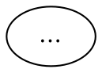

- `gl_mapping="commands"` — unlabeled edges are pipes; node text is the command.
- `gl_mapping="dataflow"` — node text is data; edge `label` is the command.
- `gl_mapping="typed"` (default) — roles drive everything; unspecified roles
  default to `program` for box-ish shapes and `file` for `note`.

The mapping only changes *defaults*; explicit `gl_role`/ports always win, so the
three are interoperable within one file.

**`gl_mapping` is file-level only — it does not cascade per subgraph.** The
mapping is the file's *reading frame*: it decides the most basic question about
any node (is this box a program or a value? is the command on the node or the
edge?). Letting it vary by cluster would mean the same picture means different
things in different regions, and that a node silently changes meaning when
cut-and-pasted across a cluster boundary — exactly the "same picture, two
meanings" hazard §3 forbids for styling, but for something far more load-bearing
than color. When a file genuinely needs to mix styles, that is what the **Typed**
mapping is for (per-element roles).

For *locality* without a second reading frame, use dot's own per-subgraph
**default attributes** (or `default.role=` / `default.edge=` on a `#gl begin`
block in `modl`) to give a region a flavor. `gl_role` and `gl_edge` defaults
cascade into child blocks, so a cluster can lean toward, say, value nodes or
sequencing edges without restating roles per element:

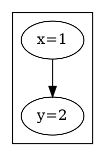

This is native dot cascading (harmless to misread, and what users already
expect), and it captures most of what a per-subgraph mapping would offer without
changing what a node fundamentally *is*.

---

### Content-addressed file nodes

A file node labeled `t256:CID[.ext]` is a source and emits `t256 load CID`.
A file node labeled `t256:` is a sink and emits `t256 save -f t256 -`;
its reference is written to stdout. Both participate in pipes as programs do,
including `<(t256 load CID)` at fan-in operators. Sources cannot have incoming
edges, and sinks cannot have outgoing edges (E14). A pipeline using either
emits this guard after the prologue:

```bash
command -v t256 >/dev/null || { echo "gripeline: t256 not found" >&2; exit 127; }
```

CID validation is purely syntactic: an eight-character base64url six-byte
length prefix, followed by canonical unpadded base64url. Lengths up to 64
carry exactly that many inline bytes; larger lengths carry a 64-byte SHA-512
hash (86 characters). Suffix labels contain only ASCII letters and digits,
separated by dots. Malformed references are **E14**. No static check loads
content or contacts a network. `#gl t256` (dot: `gl_t256=true`) also interprets
bare CID labels on file nodes as references.

Compatibility: file labels beginning `t256:` now name content, replacing the
previous interpretation as literal local filenames.


## 5. File descriptors and ports

Graphviz nodes have named **ports** — the little connection points you can attach
edges to. gripeline maps **ports to file descriptors**, which makes stream
routing visually exact and absorbs the parts of bash redirection that are usually
hard to read. (In `modl`, where `:` is a legal node-id character, ports are
written on the edge pragma as `#gl from=err to=out`; see [§14.2](#142-the-gl-pragma-language).)

**Port → fd mapping** (names are case-insensitive; either form works):

| port name          | fd  |
|--------------------|-----|
| `in`  / `stdin`  / `0` | 0 |
| `out` / `stdout` / `1` | 1 |
| `err` / `stderr` / `2` | 2 |
| `3`, `4`, …        | that fd |

**Defaults:** a tail with no port means `out` (1); a head with no port means
`in` (0). Therefore the bare `a -> b` is `a:out -> b:in` is `a | b`.

**Arbitrary fds — routing (any N).** Any port number is allowed, not just
`0`/`1`/`2`. A numbered port wired to a file or another node is a plain
*redirection*, which is order-independent and emitted directly:

```dot
gen   [label="gen"]
trace [shape=note,label="trace.out"]
gen:3 -> trace                //  gen 3> trace.out   (fd 3 → file)
```

**Routing examples (Commands/Typed):**

```dot
make [label="make"]
errlog [shape=note,label="build.err"]
make:err -> errlog            //  make 2> build.err

deploy[label="deploy"]
make:out -> deploy:in         //  make | deploy   (explicit; same as make->deploy)
```

**fd duplication is deliberately limited.** An edge from one port to another port
*on the same node* is an fd *dup* (`M>&N`). The classic `2>&1` is supported:

```dot
build [label="make"]
build:err -> build:out        // make 2>&1   (stderr follows stdout)
```

But a graph is an *unordered* set of edges, whereas fd dups are an *ordered*
sequence of mutations to a shared descriptor table — `2>&1 1>file` differs from
`1>file 2>&1`. gripeline therefore models fd *routing* (which fd goes where) but
**not** fd *dup ordering*. A node carrying more than one dup, or a dup combined
with a redirect of the same fd, is ambiguous and **not executable** (§9, E09);
the diagnostic points you to `gl_raw` for order-sensitive surgery:

```dot
sw [gl_raw="cmd 3>&1 1>&2 2>&3 3>&-"]   // stdout/stderr swap: order matters
```

This keeps the readable win (numbered redirections — the legible case) without
taking on bash's order-dependent dup semantics in a model that has no order.

> In the Dataflow mapping, where edges are programs, fd routing on a *program
> edge* is expressed with edge attributes instead (`gl_stderr="file"`,
> `gl_fd="2>&1"`), because Dataflow has no node to hang a port on. This asymmetry
> is one of Dataflow's costs.

---

### Program fd routing

A program edge with default ports (stdout 1 to stdin 0) emits a pipe.
Non-default ports use process substitutions: `a:err -> b` emits
`a 2> >(b)`, `a -> b:3` emits `b 3< <(a)`, and `a:2 -> b:3`
emits `b 3< <(a 2>&1 >/dev/null)`. An independent stdout pipe remains
available, for example `a 2> >(b) | c`. Routing is declarative; the
compiler chooses the required redirect order. Bash does not wait for these
process substitutions: completion and exit status of their commands are not
included in the enclosing pipeline's status. Substitutions must form a forest
over ordinary pipe chains: shared or cyclic nesting, or a substituted producer
with an additional pipe successor, is rejected as E09; use `gl_raw` for those
topologies rather than implicitly executing a command twice.

## 6. Control flow

Pipelines describe *data* dependency. Bash also has *ordering* and *conditional*
dependency (`;`, `&&`, `||`) and *grouping* (`( )`, `{ }`, functions). gripeline
expresses these with **control edges** and **clusters**.

### 6.1 Sequencing and conditionals — control edges

A control edge carries ordering, not a stream. Set `gl_edge`:

| `gl_edge` | bash between tail and head | recommended styling (dot)    | modl shorthand (§14.1) |
|-----------|----------------------------|------------------------------|------------------------|
| `seq`     | `tail ; head`              | `style=dashed`               | `dashed` or `dashed ;` |
| `and`     | `tail && head`             | `color=darkgreen,label="&&"` | `dashed &&`            |
| `or`      | `tail \|\| head`           | `color=orange,label="\|\|"`  | `dashed \|\|`          |

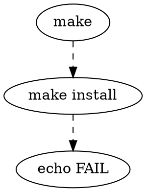

Control edges define an ordering DAG; the transpiler emits statements in a
topological order consistent with both control edges and data edges.

**Concurrency (resolved, §13):** independent nodes — those with no path between
them — are emitted **sequentially in source order by default**. To run a node
concurrently, set `gl_async=true`; the transpiler emits it with a trailing `&`
and adds a `wait` at the join. This keeps the common case reproducible while
leaving an explicit opt-in for parallel fan-out.

**Ordering ambiguity (resolved, §13):** when several topological orders are
valid, the transpiler picks a **deterministic order = source order**. Running
with `--strict` instead makes ambiguity an error, forcing the author to add
enough control edges to disambiguate.

### 6.2 Grouping — subshells, brace groups, functions

A `subgraph cluster_*` (or `#gl begin ID … #gl end` in `modl`) is a group. Its
`gl_role` chooses the kind:

| cluster `gl_role`          | bash                           |
|----------------------------|--------------------------------|
| `subshell` *(default)*     | `( … )`                        |
| `group`                    | `{ …; }`                       |
| `function` + `gl_name=foo` | `foo() { …; }` (defined, then callable by a node `label="foo"`) |

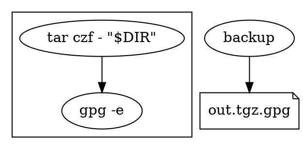

---

## 7. Variables and command substitution

A **value node** (`gl_role=value`, drawn `shape=oval` in `dot` or `diamond` in
`modl`) is a shell variable.

- **Definition.** The node's `label` is `NAME=expr`, or just a value with the id
  as the name. `today [gl_role=value,label="today=$(date +%F)"]` → `today=$(date
  +%F)`.
- **Capture from a command (Commands/Typed).** An edge from a program node to a
  value node captures stdout: `cmd -> ver [gl_role=value]` with `gl_name=VER` →
  `VER=$(cmd)`.
- **Capture in Dataflow** is free: every node is already a value, so
  `ver [label="$(git describe)"]` *is* the assignment, and downstream edges
  reference it.
- **Use.** Any `$NAME` / `${NAME}` written inside a `label` is passed through to
  bash **literally** (the quoting boundary is resolved in §13: gripeline never
  re-quotes label text; `gl_raw` is the escape hatch). A `value -> program` edge
  means "make this variable available to this command"; the transpiler ensures
  the assignment precedes the use in the emitted ordering.

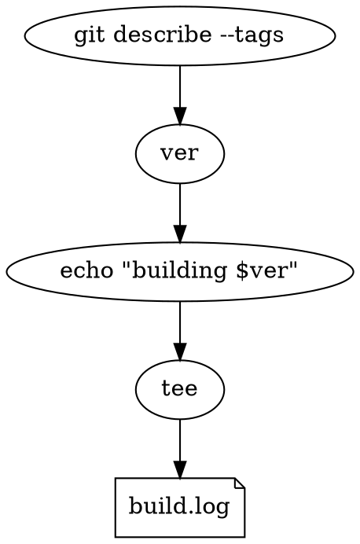

---

## 8. Loops

Two flavors, matching bash's two common loop shapes.

### 8.1 Iteration loops — annotated cluster

A `subgraph cluster_*` (or `#gl begin ID` block in `modl`) with a `gl_loop`
(`loop=` in `modl`) attribute is a loop body; the attribute is the loop header,
and the cluster's contents are the body, run per iteration.

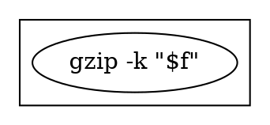

`gl_loop` headers the spec recognizes:

| `gl_loop` value                | bash                                  |
|--------------------------------|---------------------------------------|
| `for VAR in WORDS`             | `for VAR in WORDS; do … done`         |
| `while COND`                   | `while COND; do … done`               |
| `until COND`                   | `until COND; do … done`               |
| `while read VAR`               | `while read VAR; do … done` (fed by an in-edge → `done < input`) |

A `while read` loop fed by a data edge wires that edge to the loop's stdin:

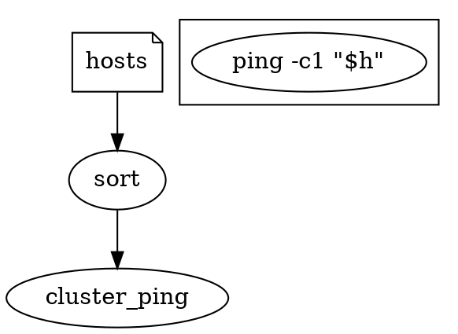

### 8.2 Feedback loops — cycles (resolved)

A *cycle in the data edges* expresses feedback. **Resolved (§13): an undeclared
data cycle is not executable** (§9, E04). To make a cycle executable you must
declare its semantics explicitly, either:

- `gl_role="coproc"` on the node that closes the loop → a `coproc` (bidirectional
  fifo pair); or
- `gl_loop="while …"` on a cluster that contains the cycle → a streaming loop.

This avoids guessing stream semantics from a picture that merely happens to have
a back-edge.

---

## 9. Renderable but not executable

Many valid pictures are not valid programs. gripeline distinguishes the two and,
when a graph can't run, reports why — both as text on stderr and, with
`--annotate`, as a copy of the graph where the offending elements are colored
red and annotated with the diagnostic message, so the *rendered picture explains
itself*.

**Executability conditions** (failing any one makes the graph not executable):

| code | condition                                                       | reported reason |
|------|-----------------------------------------------------------------|-----------------|
| E01  | graph is `digraph` (not undirected `graph`; N/A in `modl`)      | "data flow needs direction; use `digraph`" |
| E02  | every program node has operation text (non-empty label or id)  | "node `x` has no operation" |
| E03  | no two data edges target the same fd of one node without a defined merge | "fd 0 of `x` has 2 inputs; use fan-in (`gl_role=op`/`cat`)" |
| E04  | data edges are acyclic *unless* the cycle is a declared `coproc`/loop | "data cycle `x→y→x` without loop/coproc semantics" |
| E05  | control edges are acyclic                                       | "ordering cycle among `a,b`" |
| E06  | every edge has a defined transpilation for its endpoint roles  | "edge `file→file` has no program between them" |
| E07  | a port refers to a fd only on a node that has one (no fds on file/value) | "`f:err` — file nodes have no fd 2" |
| E08  | at most one capture target per value, no conflicting captures  | "value `v` captured by 2 commands" |
| E09  | a node has at most one fd dup, and no dup competing with a redirect of the same fd | "fd dups on `x` are order-sensitive; use `gl_raw`" |
| E10  | every `#gl` pragma in `modl` has known keys, valid values/ports, balanced blocks, and non-conflicting group ids | "unknown pragma key / invalid port / unbalanced `#gl begin`" |
| E11  | every `dashed` control edge in `modl` (Commands/Typed) has text `&&`, `\|\|`, `;`, or empty | "dashed edge has invalid control text (expected `&&`, `\|\|`, or `;`)" |
| E12  | every shell variable or function name is a valid shell identifier (`[A-Za-z_][A-Za-z0-9_]*`) | "variable/function name `my-var` is not a valid shell identifier" |
| E13  | every loop has a header (`gl_loop` / `loop=`), and every loop, subshell, group and function has at least one member | "loop `x` has no loop header" / "loop `each` has an empty body" |
| E14 | t256 references are syntactically valid; sources have no incoming edges and sinks no outgoing edges | "invalid t256 CID alphabet or length" |

**Output contract for a non-executable graph:**

```
$ gripeline run pipeline.dot
gripeline: pipeline.dot not executable (2 problems)
  - [E04] data cycle a -> b -> a without loop/coproc semantics
          declare gl_role="coproc" on a, or gl_loop on the cluster
  - [E02] node "filter" has no operation (empty label, id is not a command)
exit status: 65
```

Exit codes: `0` ran OK; `2` CLI or syntax/parse error; `65` not executable
(static check failed); `>0` other codes propagate the bash pipeline's status
(`pipefail` semantics by default).

A graph that is *executable* may still be *un-drawable nicely*, and vice versa;
the two properties are independent, which is the whole point.

---

## 10. Reserved attribute reference

All gripeline attributes live in the `gl_*` namespace in `dot` (and in `#gl`
comment pragmas without the `gl_` prefix in `modl`, §14.2) so they never collide
with the renderer's own attributes.

**Graph attributes**

| dot attribute   | modl pragma        | values                       | meaning                          |
|-----------------|--------------------|------------------------------|----------------------------------|
| `gl_mapping`    | `#gl mapping=…`    | `commands` `dataflow` `typed`| default convention (§4.4)        |
| `gl_prologue`   | `#gl prologue=…`   | shell text                   | replaces default `set -euo pipefail` |
| `gl_shell`      | `#gl shell=…`      | `bash` (only, for now)       | target shell                     |

**Node attributes**

| dot attribute | modl pragma    | values                                           | meaning                       |
|---------------|----------------|--------------------------------------------------|-------------------------------|
| `gl_role`     | `role=…`       | `program` `file` `stream` `value` `op` `coproc` `for` `while` `until` `if` `function` `subshell` `group` | role (§4.3, §6, §8) |
| `gl_name`     | `name=…`       | identifier                                       | variable/function/capture name |
| `gl_append`   | `append=true`  | `true` / `false`                                 | file write uses `>>`          |
| `gl_async`    | `async=true`   | `true` / `false`                                 | run in background (`&`)       |
| `gl_loop`     | `loop=…`       | loop header string                               | cluster is a loop (§8)        |
| `gl_raw`      | `raw=…`        | shell text                                       | escape hatch: emit verbatim   |

**Edge attributes**

| dot attribute | modl pragma         | values                  | meaning                                   |
|---------------|---------------------|-------------------------|-------------------------------------------|
| `gl_edge`     | `edge=…`            | `pipe`(default) `seq` `and` `or` `redirect` | edge kind (§3, §6)    |
| `gl_stderr`   | `stderr=…`          | path / `2>&1`           | (Dataflow) fd routing for a program edge  |
| `gl_fd`       | `fd=…`              | raw redirection         | (Dataflow) arbitrary fd op on the edge    |
| *(port)*      | `from=…` / `to=…`   | `in` `out` `err` `0`…   | tail / head fd port in `modl` (§5, §14.2) |

**Operation text** comes from `label` (node, or edge in the Dataflow mapping),
falling back to the node id. Anything inside `label` (or a `modl` node/edge raw
text slice, §14.1 D1) is treated as a bash command/word list and emitted as
written (you quote inside the label exactly as you would in bash).

---

## 11. Conformance

A conforming **transpiler**:

1. MUST parse standard `dot` (including `subgraph`, ports, and default
   `node`/`edge`/`graph` statements) and standard `modl` (including `#gl`
   comment pragmas and `#gl begin` / `#gl end` blocks).
2. MUST ignore every attribute outside the reserved set and the role-shape /
   modl-dashed set; in particular it MUST NOT change behavior based on `color`,
   `pos`, `fontname`, `size`, `url`, or `background` (unless `--infer-style` is
   explicitly requested).
3. MUST run the §9 static check before emitting bash and refuse non-executable
   graphs with exit code `65` (and refuse syntax/parse errors with exit code `2`).
4. MUST emit bash whose behavior, under the (possibly overridden) prologue,
   realizes the semantics in §§4–8. The emitted bash is the normative meaning,
   and equivalent `dot` and `modl` sources MUST transpile to the same bash.
5. SHOULD offer `gripeline build` (print bash) distinct from `gripeline run`.
6. SHOULD offer `--annotate` to write a diagnostic-annotated `.annotated.dot` or
   `.annotated.modl` copy.

A conforming **diagram** is any valid `dot` or `modl` file; conformance is a
property of the *tool*, not the source. Every diagram is renderable; the tool
decides executability per §9.

The test harness in [`tests/`](tests/) encodes this contract as fixtures (see
[tests/README.md](tests/README.md)).

---

## 12. Example gallery

Each example gives the **bash** first (the gloss), then the **same program in
`dot` and `modl`**. Recall the recommended workflow is to *author* in whichever
mapping and source language reads best; these side-by-sides exist to show the
correspondence. Every example here also exists as a twin fixture under
`tests/cases/`.

### 12.1 A plain three-stage pipe

```bash
cat access.log | grep 404 | wc -l
```

```modl
#gl mapping=commands
a square cat access.log
b square grep 404
c square wc -l
a -> b -> c
```

```modl
#gl mapping=dataflow
access_log -> hits grep 404
hits       -> n    wc -l
access_log hex access.log
```

```modl
log hex    access.log
g   square grep 404
w   square wc -l
log -> g -> w
```
*Commands is shortest here; Dataflow pays for naming the streams.*

### 12.2 Redirection in and out

```bash
grep 404 < access.log | wc -l > counts.txt
```
```dot
/* Commands */ digraph { gl_mapping="commands"
  in [shape=note,label="access.log"]
  out[shape=note,label="counts.txt"]
  g[label="grep 404"] w[label="wc -l"]
  in -> g -> w -> out }
```
```modl
#gl mapping=commands
in  hex    access.log
out hex    counts.txt
g   square grep 404
w   square wc -l
in -> g -> w -> out
```
```dot
/* Dataflow */ digraph { gl_mapping="dataflow"
  access_log -> hits [label="grep 404"]
  hits -> counts     [label="wc -l"]
  access_log[shape=note,label="access.log"] counts[shape=note,label="counts.txt"] }
```
```modl
#gl mapping=dataflow
access_log -> hits   grep 404
hits       -> counts wc -l
access_log hex access.log
counts     hex counts.txt
```
```dot
/* Typed */ digraph {
  in[shape=note,label="access.log"] out[shape=note,label="counts.txt"]
  g[label="grep 404"] w[label="wc -l"]
  in -> g -> w -> out }
```
```modl
in  hex    access.log
out hex    counts.txt
g   square grep 404
w   square wc -l
in -> g -> w -> out
```

### 12.3 stderr routing (`2>` and `2>&1`)

```bash
make 2> build.err            # case 1
make 2>&1 | grep -i error    # case 2
```
```dot
/* Commands/Typed, case 1 */ digraph {
  errlog[shape=note,label="build.err"]
  make[label="make"]
  make:err -> errlog }
```
```modl
errlog hex    build.err
make   square make
make -> errlog #gl from=err
```
```dot
/* Commands/Typed, case 2 */ digraph {
  make[label="make"] g[label="grep -i error"]
  make:err -> make:out        // 2>&1
  make:out -> g }             // | grep -i error
```
```modl
make square make
g    square grep -i error
make -> make #gl from=err to=out
make -> g    #gl from=out
```
```dot
/* Dataflow, case 2 (fd via edge attrs) */ digraph { gl_mapping="dataflow"
  build -> errs [label="grep -i error", gl_stderr="2>&1"]
  build[label="make"] }
```
```modl
#gl mapping=dataflow
build -> errs grep -i error #gl stderr="2>&1"
build make
```
*Ports make fd routing crisp in Commands/Typed; Dataflow expresses it with edge
attributes.*

### 12.4 Fan-out (`tee` / process substitution)

```bash
sort data.txt | tee >(head -1 > first.txt) >(tail -1 > last.txt) > sorted.txt
```
```dot
/* Commands/Typed */ digraph {
  data[shape=note,label="data.txt"]
  sorted[shape=note,label="sorted.txt"]
  first[shape=note,label="first.txt"] last[shape=note,label="last.txt"]
  s[label="sort"] h[label="head -1"] t[label="tail -1"]
  data -> s
  s -> sorted          // main output
  s -> h  h -> first   // branch 1  (via tee >(…))
  s -> t  t -> last    // branch 2
}
```
```modl
data   hex    data.txt
sorted hex    sorted.txt
first  hex    first.txt
last   hex    last.txt
s      square sort
h      square head -1
t      square tail -1
data -> s
s -> sorted
s -> h
h -> first
s -> t
t -> last
```
```dot
/* Dataflow */ digraph { gl_mapping="dataflow"
  data -> sorted [label="sort"]
  sorted -> first [label="head -1"]
  sorted -> last  [label="tail -1"]
  data[shape=note,label="data.txt"] sorted[shape=note,label="sorted.txt"]
  first[shape=note,label="first.txt"] last[shape=note,label="last.txt"] }
```
```modl
#gl mapping=dataflow
data   -> sorted sort
sorted -> first  head -1
sorted -> last   tail -1
data   hex data.txt
sorted hex sorted.txt
first  hex first.txt
last   hex last.txt
```
*Fan-out is where Dataflow reads best: one value, several consumers, no `tee`
noise.*

### 12.5 Fan-in (multiple inputs to one program)

```bash
cat <(curl -s host1/metrics) <(curl -s host2/metrics) | sort | uniq -c
```
```dot
/* Commands/Typed */ digraph {
  c1[label="curl -s host1/metrics"]
  c2[label="curl -s host2/metrics"]
  merge[label="cat", gl_role=op]    // op node: many inputs → cat <(..) <(..)
  s[label="sort"] u[label="uniq -c"]
  c1 -> merge
  c2 -> merge
  merge -> s -> u
}
```
```modl
c1    square curl -s host1/metrics
c2    square curl -s host2/metrics
merge square cat #gl role=op
s     square sort
u     square uniq -c
c1 -> merge
c2 -> merge
merge -> s -> u
```
```dot
/* Dataflow (needs an op node too — Dataflow's awkward case) */
digraph { gl_mapping="dataflow"
  m1 -> merged [label="curl -s host1/metrics"]
  m2 -> merged [label="curl -s host2/metrics"]   // two edges into one value node
  merged -> counted [label="sort | uniq -c"]
}
```
```modl
#gl mapping=dataflow
m1     -> merged  curl -s host1/metrics
m2     -> merged  curl -s host2/metrics
merged -> counted sort | uniq -c
```
*Multi-input forces an `op`/merge node; this is the seam where both Commands and
Dataflow bend toward Typed.*

### 12.6 Sequencing and conditionals (`&&`, `||`)

```bash
make && make install || echo FAIL
```
```dot
/* Commands/Typed */ digraph {
  make[label="make"] inst[label="make install"] fail[label="echo FAIL"]
  make -> inst [gl_edge=and, style=dashed, color=darkgreen]
  inst -> fail [gl_edge=or,  style=dashed, color=orange]
}
```
```modl
make square make
inst square make install
fail square echo FAIL
make -> inst dashed green &&
inst -> fail dashed orange ||
```
*Dataflow is ill-suited to control flow; author conditionals in Commands/Typed.*

### 12.7 Subshell / function (grouping)

```bash
backup() { tar czf - "$DIR" | gpg -e; }
backup > out.tgz.gpg
```
```dot
/* Commands/Typed */ digraph {
  subgraph cluster_backup {
    gl_role="function"; gl_name="backup"
    t[label="tar czf - \"$DIR\""] g[label="gpg -e"]
    t -> g
  }
  call[label="backup"] out[shape=note,label="out.tgz.gpg"]
  call -> out
}
```
```modl
#gl begin cluster_backup role=function name=backup
t square tar czf - "$DIR"
g square gpg -e
t -> g
#gl end
call square backup
out  hex    out.tgz.gpg
call -> out
```

### 12.8 Variables and command substitution

```bash
ver=$(git describe --tags)
echo "building $ver" | tee build.log
```
```dot
/* Commands/Typed */ digraph {
  git[label="git describe --tags"]
  ver[gl_role=value, shape=oval]
  echo[label="echo \"building $ver\""] tee[label="tee"] log[shape=note,label="build.log"]
  git -> ver [gl_name="ver"]          // ver=$(git describe --tags)
  ver -> echo                         // ordering: define before use
  echo -> tee -> log
}
```
```modl
git  square  git describe --tags
ver  diamond #gl name=ver
echo square  echo "building $ver"
tee  square  tee
log  hex     build.log
git -> ver #gl name=ver
ver -> echo
echo -> tee -> log
```
```dot
/* Dataflow (variable = node, very natural) */ digraph { gl_mapping="dataflow"
  ver[label="$(git describe --tags)"]
  ver -> announced [label="echo \"building $ver\""]
  announced -> log [label="tee"]
  log[shape=note,label="build.log"] }
```
```modl
#gl mapping=dataflow
ver $(git describe --tags)
ver       -> announced echo "building $ver"
announced -> log       tee
log hex build.log
```

### 12.9 A `for` loop

```bash
for f in *.txt; do gzip -k "$f"; done
```
```dot
/* Commands/Typed */ digraph {
  subgraph cluster_each {
    gl_loop="for f in *.txt"
    z[label="gzip -k \"$f\""]
  }
}
```
```modl
#gl begin each loop="for f in *.txt"
z square gzip -k "$f"
#gl end
```

### 12.10 A streaming `while read` loop

```bash
sort hosts | while read h; do ping -c1 "$h"; done
```
```dot
/* Commands/Typed */ digraph {
  hosts[shape=note,label="hosts"]
  sort[label="sort"]
  hosts -> sort
  subgraph cluster_ping {
    gl_loop="while read h"
    p[label="ping -c1 \"$h\""]
  }
  sort -> cluster_ping            // data edge into a loop = its stdin
}
```
```modl
hosts hex    hosts
sort  square sort
hosts -> sort
#gl begin ping loop="while read h"
p square ping -c1 "$h"
#gl end
sort -> ping
```

### 12.11 A fuller script (everything together)

```bash
#!/usr/bin/env bash
set -euo pipefail
ver=$(git describe --tags)
for svc in api web worker; do
  docker build -t "$svc:$ver" "./$svc" \
    && docker push "$svc:$ver" \
    || echo "FAILED $svc" >> failures.log
done | tee build.log
```
```dot
/* Typed (mix value + loop + control edges + redirect) */
digraph deploy {
  gl_prologue="set -euo pipefail"

  git [label="git describe --tags"]
  ver [gl_role=value, shape=oval]
  git -> ver [gl_name="ver"]                       // ver=$(git describe --tags)

  subgraph cluster_each {
    gl_loop="for svc in api web worker"

    build [label="docker build -t \"$svc:$ver\" \"./$svc\""]
    push  [label="docker push \"$svc:$ver\""]
    fail  [label="echo \"FAILED $svc\""]
    flog  [shape=note, label="failures.log", gl_append=true]

    build -> push [gl_edge=and, style=dashed]      // && docker push
    push  -> fail [gl_edge=or,  style=dashed]      // || echo FAILED
    fail  -> flog                                  // >> failures.log
  }

  tee  [label="tee"]
  blog [shape=note, label="build.log"]
  cluster_each -> tee                               // loop stdout | tee build.log
  tee -> blog

  ver -> cluster_each                               // ordering: ver before loop
}
```
```modl
#gl prologue="set -euo pipefail"
git square  git describe --tags
ver diamond #gl name=ver
git -> ver  #gl name=ver

#gl begin each loop="for svc in api web worker"
build square docker build -t "$svc:$ver" "./$svc"
push  square docker push "$svc:$ver"
fail  square echo "FAILED $svc"
flog  hex    failures.log #gl append=true
build -> push dashed &&
push  -> fail dashed ||
fail  -> flog
#gl end

each -> tee
tee  square tee
blog hex    build.log
tee  -> blog
ver  -> each dashed
```

Both files render as a deploy diagram *and* run as the exact same bash script
above.

---

## 13. Resolved decisions

All design questions raised through Draft 0.4 are now resolved and folded into
the sections noted:

1. **Data cycles** (§8.2, §9 E04) — an undeclared data cycle is *not executable*;
   the author must declare `gl_role="coproc"` or a `gl_loop`. No inference.
2. **Concurrency** (§6.1) — independent nodes run *sequentially in source order*;
   `gl_async=true` opts a node into background execution (`&` + `wait`).
3. **Ordering ambiguity** (§6.1) — resolved *deterministically by source order*;
   `--strict` turns ambiguity into an error instead.
4. **Quoting boundary** (§7, §10, §14.1 D1) — label text is emitted *literally*;
   gripeline never re-quotes. The `gl_raw` attribute is the escape hatch for
   anything the readable forms can't express.
5. **Arbitrary file descriptors** (§5, §9 E09) — any port number is first-class
   for *routing* (`gen:3 -> file` → `3> file`); fd *duplication* is limited to
   the order-independent `2>&1` shape, and order-sensitive dup surgery is an
   ambiguity error (E09) directing the author to `gl_raw`. Rationale: a graph is
   unordered, fd dups are an ordered sequence of table mutations, so gripeline
   models fd routing but not dup ordering.
6. **Per-subgraph mappings** (§4.4) — `gl_mapping` stays *file-level only*; it is
   the file's single reading frame. Mixing styles is the job of the Typed mapping
   (per-element roles), and per-region *locality* is achieved with dot's native
   cascading `gl_role`/`gl_edge` subgraph defaults (or `default.role=` /
   `default.edge=` on a `#gl begin` block in `modl`) — not a second mapping.

---

## 14. modl source

[`modl`](https://modl.hashbin.page/) is a lightweight, line-oriented diagram
language. A `.modl` file can be opened and edited directly in the
[modl editor](https://modl.hashbin.page/) and executed by `gripeline` with zero
changes to modl's own grammar.

### 14.1 Design rules (D1–D5)

- **D1. Operation text is the raw source slice.** `gripeline` takes a node's (or
  edge's) operation text as the exact source characters from the first text word
  to the start of the `#` comment, with trailing whitespace trimmed (and an
  explicit `""` treated as an empty label for E02). Thus:
  ```modl
  echo square echo "building $ver"
  ```
  renders in the modl editor as `echo building $ver` (modl strips quotes when
  displaying text) and runs in bash as `echo "building $ver"`. This preserves
  §13.4 ("label text is emitted literally; gripeline never re-quotes").

- **D2. Shape → role table (`modl` only).**

  | modl shape                  | role                                                  |
  |-----------------------------|-------------------------------------------------------|
  | `square`                    | `program`                                             |
  | `hex`                       | `file`                                                |
  | `triangle`                  | `stream`                                              |
  | `diamond`                   | `value`                                               |
  | `circle` (default), `none`  | mapping default (`program`; `value` in `dataflow`)    |

  An explicit `#gl role=…` pragma always wins. Leaving `circle` and `none`
  neutral means an unstyled diagram (`a -> b -> c`) is a plain Commands pipe.
  Size (`tiny` … `huge`), color, URL, and background lines (a line holding only
  a color word) never affect execution. modl fills a line's attribute slots
  strictly in order — size, shape (edges: line style), color, URL, then text —
  so a keyword out of that order is text, in the picture *and* in the command;
  `gripeline` warns when text starts with such a keyword.

- **D3. Line style → edge kind (`modl` only).**
  - `solid` (default), `bold`, `dotted` → data edge (pipe or redirect, decided
    by endpoint roles).
  - `dashed` → **control edge** in the `commands` and `typed` mappings. Its kind
    comes from the edge text: `&&` → `and`, `||` → `or`, `;` or empty text →
    `seq`. Any other text on a `dashed` edge (without `#gl edge=…`) is an error
    (**E11**), preventing typos from silently changing control flow. In the
    `dataflow` mapping, edge text is the command, so control kinds there come
    from `#gl edge=and|or|seq` only.
  - `#gl edge=…` always wins.

- **D4. Format detection.** `.modl` selects `modl`, `.dot`/`.gv` selects `dot`,
  and `--lang=modl|dot` overrides. Otherwise `gripeline` sniffs the first token:
  `strict`/`digraph`/`graph` selects `dot`, and anything else selects `modl`.
  Inline share links (`https://modl.hashbin.page/#h1=…`) are decoded locally
  from `base64url(JSON {src, pos})` and parsed as `modl` without network access
  (256t CID links are refused with an explanation).

- **D5. `modl` parse errors are fatal.** Although the modl editor skips invalid
  lines and renders the rest, `gripeline` refuses to run a partially-parsed
  program and exits `2` with modl's diagnostic (`Line N: invalid node id "x"`,
  `Line N: empty node id`, `Line N: malformed edge line`).

### 14.2 The `#gl` pragma language

A pragma is a `modl` comment whose body begins with `gl` followed by whitespace
(`#gl …` at the start of a line or after whitespace). Because `modl`'s lexer
discards comments, pragmas are completely invisible to the modl renderer. Inside
a pragma, attributes are `key=value` words (using the §10 names without the
`gl_` prefix), values may be double-quoted with `\"` and `\\` escapes, and a
trailing `# …` after whitespace starts a normal comment. Unknown keys or invalid
values are reported as **E10**.

1. **Trailing pragmas** attach to the element on that line:
   - On a **node line**, valid keys are `role`, `name`, `append`, `async`, `raw`.
     Node lines can repeat; later lines win key-by-key, matching modl's own
     redefinition rule.
   - On an **edge line**, valid keys are `edge`, `stderr`, `fd`, `name`, plus
     ports `from=` (tail port) and `to=` (head port) using the §5 names
     (`in`/`out`/`err`/`0`/`1`/`2`/`3`…). On a chain `a -> b -> c`, trailing
     attributes and pragmas apply to every edge in the chain.

2. **Whole-line pragmas** stand on their own line:
   - `#gl mapping=commands|dataflow|typed`, `#gl prologue="…"`, `#gl shell=bash`
     set graph attributes, including inside an open block; these whole-line
     keys never target the block.
   - `#gl node ID key=val…` sets attributes on node `ID` without restyling it.
     `ID` must also appear on a modl line (node line or edge endpoint);
     otherwise modl would never draw it, so it is an error (**E10**). The
     pragma does not count as a mention for block membership.
   - Whole-line `#gl edge …` is not allowed (**E10**); use a trailing pragma on
     the edge line.

3. **Block pragmas (`#gl begin` / `#gl end`)** express clusters and loops:
   - `#gl begin ID key=val…` and `#gl end` open and close a nestable group `ID`.
     Valid keys are `role=subshell|group|function|for|while|until`, `name=…`,
     `loop=…`, and member defaults `default.role=…` and `default.edge=…`.
   - A node belongs to the innermost block where it is *first mentioned* (node
     line or edge endpoint); lines outside the block can still visually style it.
   - An edge belongs to the innermost scope that holds both of its endpoints,
     not to the block it is written in: `build -> push dashed &&` written after
     `#gl end` still joins `build` and `push` inside the loop. An edge from
     outside into a member addresses the member's enclosing group (e.g. a
     value `ver -> build` orders `ver` before the loop). The same holds for
     dot clusters.
   - Using `ID` as an edge endpoint addresses the group itself (e.g.
     `each -> tee` pipes the loop's stdout into `tee`). In `modl`, `ID` can also
     be styled as a visible stand-in node (e.g. `each big diamond for each svc`),
     but giving a group `ID` a node `role` is an error (**E10**).

### 14.3 `--annotate` and lints for `modl`

Running with `--annotate` on a non-executable `.modl` file writes
`<name>.annotated.modl`: offending nodes get an appended `ID red` redefinition
line, offending edge lines have `red` placed in their color slot, and each
diagnostic is appended as a `# [Exx] …` comment (`red` goes after any size and
line style, so modl still reads the edge's slots in order) so the file opens in the modl
editor with offending elements highlighted in red.

`gripeline` also emits non-fatal lint warnings on `stderr` for `modl` traps:
a non-dashed edge whose text is `&&` or `||` (in `dataflow`, where that text
would run as a command), a `dashed` edge in `dataflow` without `#gl edge=…`
(it is a data edge there), text that starts with an attribute keyword out of
modl's slot order (e.g. `a red square …` makes `square` text), an unquoted
`/path` swallowed by modl's URL slot (e.g. `/usr/bin/wc -l`), and labels longer
than modl shows (22 characters for nodes, 28 for edges).

The `tests/` harness checks the modl front end against modl itself: with
`MODL_REPO` pointing at a `curtcox/modl` checkout, `tests/modl_parse.cjs` runs
modl's own `parseSource` and every fixture must parse to the same nodes,
shapes, text and edges in both.

### 14.4 Native modl extensions

The standalone modl parser (`js/parse.js`) is normative for lexical behavior.
Words and attributes expose UTF-16 source spans. `a[err] -> b[3]` supplies
endpoint ports; quoted bracket text is supported. Trailing `from=` / `to=`
pragmas override bracket ports. A `double` edge defaults its source port to
stderr; an explicit port or pragma overrides that default.

A node line ending in an unquoted `{` opens a nested group; a line containing
only `}` closes it. The title supplies a loop header if it starts with
`for`, `while`, or `until`; otherwise the default role is `group`. A trailing
pragma on the opener accepts the same block keys as `#gl begin`. The legacy
`#gl begin` / `#gl end` spelling remains a deprecated alias for this release.
Membership follows first mention, as for pragma blocks. Reusing a block ID
is E10. Text on a non-loop group is display-only and produces a warning.

Additional shapes map as follows: `note` and `cylinder` are files,
`parallelogram` is a stream, and `subroutine` is a program (its operation text
can call a shell function). `hex` remains a file alias. `stadium` and `oval`
use the normal default role. Quoted strings immediately after `[` are now recognized by the lexer, including
in operation text; raw shell slices are preserved, but display quoting there
can change. New shape/style keywords consume their attribute
slot where previously they began text; quote such text to preserve its old
meaning. A bare trailing `{` now opens a group; quote a literal brace.

Quoted control labels use their display text for control classification;
raw shell text remains unchanged in the dataflow mapping. Warnings also flag
ignored text in non-final chain segments, near-miss pragma comments, and
whitespace outside shell quotes other than space/tab. Dataflow diagnostics
and annotation refer to original source elements, never generated IDs.
Annotation preserves source line endings and legal quoted line separators.

`--annotate --link` writes a review URL to stderr on static-check failure,
without writing an annotated file. Its `&mark=...` fragment highlights node
IDs and `L<number>` source lines, leaving source unchanged. Exit status remains
65 and failed builds keep stdout empty. The modl editor retains full labels
on hover/focus, provides a persistent raw-text view, and lays out unsaved nodes
in deterministic left-to-right layers. Saved positions take precedence.

This CLI does not advertise the unimplemented `--strict` and `--infer-style`
options; the optional modes described elsewhere remain future capabilities.

### 14.5 Requirements and environments

`#gl requires jq python3 t256` declares required commands (dot:
`gl_requires="jq python3 t256"`). Tool names contain ASCII letters, digits,
`_`, `+`, `.`, or `-`; other names are E10. Emitted bash checks every named
command with `command -v`, reports all missing commands, and exits 127 before
running the pipeline. These declarations are independent of t256's guard.

`#gl env linux macos windows apptron` limits intended targets (dot:
`gl_env="linux macos windows apptron"`). Unknown environments are E10.
This is editor metadata, not an operating-system detector in emitted bash.
An omitted declaration does not prove that arbitrary commands are portable.

`--portable` adds advisory warnings for first command words outside this set:
`echo printf cat tee sort uniq wc head tail cut tr sed grep awk find xargs test
true false pwd cd mkdir rm cp mv touch basename dirname env sh bash t256`.
It neither examines shell scripts recursively nor guarantees identical utility
options across platforms. Advice never changes the exit status of `check`.

### 14.6 Browser API and input references

`gripeline_api(src, lang=None)` is a pure, standard-library API returning
`lang`, `bash`, `problems` (`code`, `message`, `line`, `node`), `warnings`, and
`marks`. Parse errors have code `parse`; failed checks return empty bash.
Additional `requires` and `environments` fields expose declarations. `commands`
lists distinct first command words in source order, after leading environment
assignments and excluding diagram-defined functions. This is advisory metadata;
it does not recursively parse arbitrary shell scripts. Optional
`portable=True` enables the same advice as the CLI. It performs no file,
process, network, or terminal I/O. The CLI uses this evaluation path.

CLI input `-` reads source from stdin. CID inputs (bare, `t256:CID`, or an
HTTP(S) link whose fragment is a CID) invoke `t256 load CID`; verification is
performed by t256. A hashbin-diagram JSON envelope with version 1 is unwrapped.
Inline `#h1=` links remain supported, without t256. URL inputs now sniff source
language, allowing dot as well as modl links; `--lang` overrides detection.
Bare valid CIDs always go through verified loading, even if a same-named file
exists in the current directory. Use an explicit path such as `./CID` to read
a literal local file instead. Missing t256 or malformed inputs exit 2. `run` uses `GRIPELINE_BASH`, then Bash
on PATH, then Git for Windows installation locations. The Windows WSL launcher
is rejected; run gripeline inside WSL instead. Scripts use temporary files so
pipeline stdin remains available. Generated temporary scripts use UTF-8 and LF
line endings on every platform; Windows CLI text streams use UTF-8.
